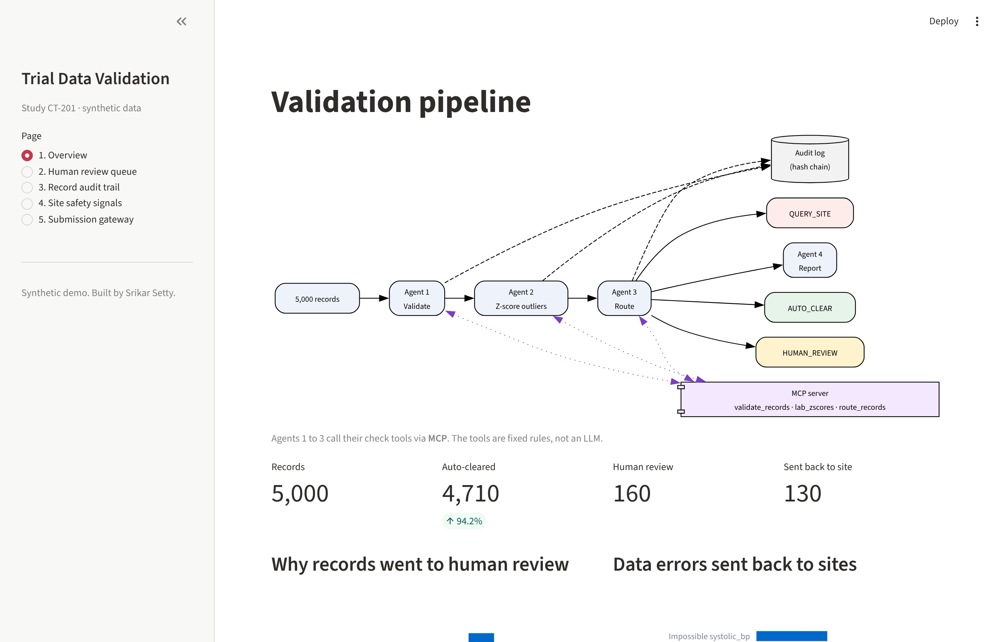
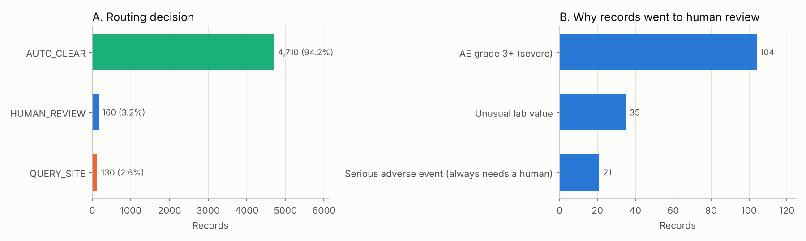
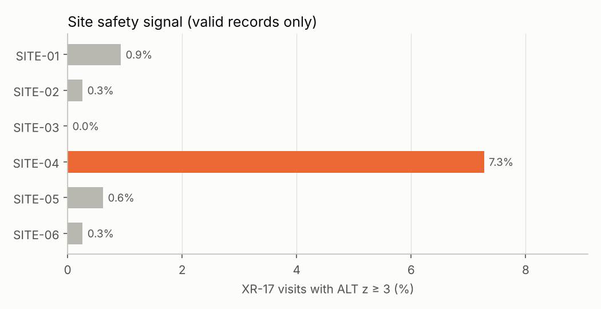
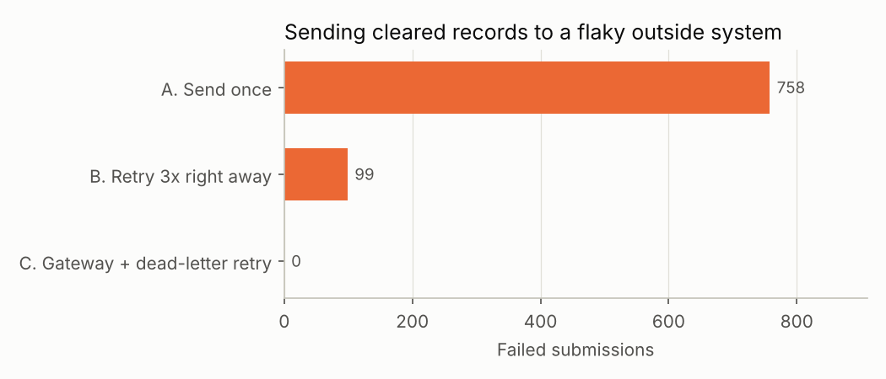

# Clinical Trial Data Validation

Checks clinical trial records automatically, sends risky ones to a human, and keeps a tamper-evident audit log of every decision.

> **All data is synthetic.** Study "CT-201" and drug "XR-17" are made up.

## Motivation

A clinical trial collects thousands of patient visits from many sites. Before that data can be used, someone has to check every record: is it complete, is it possible, is anything medically worrying? Much of this is still done by hand. It is slow, and real problems get lost in routine records.

Most records are fine and only need fixed checks. Some, like a serious adverse event or a very unusual lab value, need a person to look at them. Others are just data entry mistakes that the site should fix. We wanted a pipeline that sorts records into those three groups, explains every decision, can prove later that nothing was changed, and sends the cleared records on to the next system without losing any.

## Overview

5,000 synthetic visits go through 4 agents. Agents 1 to 3 check, score, and route each record by calling **tools** served by an MCP server. Agent 4 writes a short summary. Every decision goes into an append-only audit log with a SHA-256 hash chain, so editing any old entry is detected.

```
5,000 records ─► Agent 1 Validate ─► Agent 2 Z-score ─► Agent 3 Route ─► Agent 4 Report
                      │                    │                 │
                      └────────────────────┴─────────────────┴──► Audit log (hash chain)
                                                             │
                     AUTO_CLEAR   ─► Submission gateway ─► outside system
                     HUMAN_REVIEW ─► review queue (decision also logged)
                     QUERY_SITE   ─► back to the site to fix
```

A 5-page Streamlit app shows the results, holds the human review queue, shows each record's audit trail, and flags site safety signals.

<a href="images/app_overview.png"></a>

## Methodology

1. **Data:** 5,000 visits (1,000 patients, 6 sites, XR-17 vs placebo) with planted problems: missing fields, visits before consent, impossible values, wrong arm codes, duplicates, and real ALT outliers. One site (SITE-04) has a hidden liver safety signal. See [`data/README.md`](data/README.md).
2. **Validate (Agent 1):** required fields, allowed arms, possible ranges (age 18-90, systolic BP 70-220, ALT 3-2000, creatinine 0.2-10), visit not before consent, AE grade present, duplicates.
3. **Z-score (Agent 2):** z-score of ALT, creatinine, and systolic BP against the mean and standard deviation of the same arm. The stats come from **valid records only**, so bad data doesn't distort them. |z| ≥ 3 is an outlier.
4. **Route (Agent 3):** first matching rule wins. Any data error → `QUERY_SITE`. Serious AE, AE grade 3+, or a lab outlier → `HUMAN_REVIEW`. Everything else → `AUTO_CLEAR`.
5. **Report (Agent 4):** counts, top error types, and a per-site safety signal (share of XR-17 visits with ALT z ≥ 3, then a z-score across sites). If Ollama (`llama3.2`) is running, the LLM writes the summary from those facts; otherwise a fixed template does.
6. **MCP:** the check logic lives in `checks.py` and is served by `mcp_server.py` as `validate_records`, `lab_zscores`, and `route_records`, in batches of 500, over stdio. With `--local` the agents call the same functions directly; results are identical. Every audit entry records the tool used and `"via": "mcp"` or `"local"`.
7. **Audit log:** each entry stores record, agent, decision, reason, rule version, time, and the hash of the previous entry. `verify()` finds the first broken entry. Optional Kafka copy.
8. **Submission:** cleared records go to a simulated outside system (8% random errors, 20 calls/second limit, a 30-second outage) three ways: send once, retry right away, or through a gateway with a token-bucket rate limiter, exponential backoff with jitter, a circuit breaker, and a dead-letter queue.

## Results

The seed is fixed, so every run gives the same numbers.

### Routing

| | |
|---|---|
| Records | 5,000 (1,000 patients, 6 sites) |
| Auto-cleared | 4,710 (94.2%) |
| Human review | 160 (serious AE, AE grade 3+, or lab z ≥ 3) |
| Sent back to site | 130 (data errors) |
| Audit log | 15,827 entries after submission, hash chain verifies; editing one entry is detected |

See [`reports/pipeline_report.md`](reports/pipeline_report.md).

<a href="images/routing.png"></a>

### Safety Signal

SITE-04: 7.3% of XR-17 visits have ALT z ≥ 3. Every other site is under 1%.

<a href="images/site_signal.png"></a>

### Submission

| Client | Failed submissions |
|---|---|
| Send once | 758 (16.1%) |
| Retry 3x right away | 99 (2.1%) |
| **Gateway + dead-letter retry** | **0** |

These numbers come from a **simulated** outside system. They show the idea, not a real system's numbers. See [`reports/submission_report.md`](reports/submission_report.md).

<a href="images/submission.png"></a>

## Design Choices

- **Rules decide, the LLM only writes.** Safety decisions must be predictable and explainable.
- **Bad data is never dropped.** It goes back to the site with the reason.
- **Z-score stats come from valid records only**, so bad data doesn't distort them.
- **Every decision stores the rule version**, so you know which rules made it.
- **Tools behind a standard interface.** The agents don't know whether they call MCP or local functions.

## Limitations

- All data is synthetic, and the planted errors are simpler than real ones.
- The rule numbers (ranges, z ≥ 3, grade 3+) are for the demo, not taken from a real protocol.
- The outside system is simulated; real systems fail in other ways too.
- The audit log is tamper-evident, not tamper-proof: it shows that an entry changed, not who changed it. The app has no login.
- The pipeline deletes `trial.db` on each run, to keep the demo fresh. A real audit log is never deleted.

## Repository Structure

```
clinical-trial-validation/
  clinical_trial_validation/
    config.py         the rule book: ranges, z threshold, AE severity, rule version
    checks.py         the checks, one record at a time (no AI)
    generate_data.py  5,000 synthetic visits with planted errors and a SITE-04 signal
    mcp_server.py     serves the checks as MCP tools
    tools.py          same interface for local or MCP tool calls
    agents.py         the 4 agents
    llm.py            optional Ollama client for Agent 4's summary
    pipeline.py       connects the agents with LangGraph, writes the pipeline report
    audit_log.py      append-only log with SHA-256 hash chain + verify(); optional Kafka
    gateway.py        rate limiter, retries with backoff + jitter, circuit breaker, dead-letter queue
    submit.py         compares 3 ways of sending records to a flaky outside system
    figures.py        draws the README figures from trial.db
    run_all.py        runs generate_data -> pipeline -> submit
  data/               generated records (ignored by git) and data/README.md
  docs/               APP_GUIDE.md: how the app and agents call the code
  images/             figures and app screenshot for the README
  reports/            pipeline and submission reports
  ui/                 the 5-page Streamlit app
  requirements.txt
```

## Quick Start (Local)

From the repo root:

```bash
python3 -m venv .venv
source .venv/bin/activate
python -m pip install -r requirements.txt
python -m clinical_trial_validation.run_all
streamlit run ui/app.py
```

`run_all` takes about 10 seconds and writes `data/trial_records.csv` and `trial.db`. Then open the URL Streamlit prints. Add `--local` to `run_all` to call the tools directly instead of through MCP. See [ui/README.md](ui/README.md) for the app and [docs/APP_GUIDE.md](docs/APP_GUIDE.md) for the code.

Optional: start Ollama with `llama3.2` and Agent 4 writes the summary with the LLM.

## Reproducing the Results

Each step can also run on its own:

```
python -m clinical_trial_validation.generate_data       # writes data/trial_records.csv
python -m clinical_trial_validation.pipeline --mcp      # writes trial.db + reports/pipeline_report.md (omit --mcp for local tools)
python -m clinical_trial_validation.submit              # writes reports/submission_report.md
python -m clinical_trial_validation.figures             # writes images/routing.png, site_signal.png, submission.png
```

## References

- [Model Context Protocol](https://modelcontextprotocol.io/), the standard the agents use to call tools
- [LangGraph](https://langchain-ai.github.io/langgraph/), connects the agents into a graph
- [NCI Common Terminology Criteria for Adverse Events (CTCAE)](https://ctep.cancer.gov/protocoldevelopment/electronic_applications/ctc.htm), the 1-5 AE grade scale
- [21 CFR Part 11](https://www.ecfr.gov/current/title-21/chapter-I/subchapter-A/part-11), FDA rules for electronic records and audit trails
- [ICH Efficacy Guidelines (E6, Good Clinical Practice)](https://www.ich.org/page/efficacy-guidelines)
